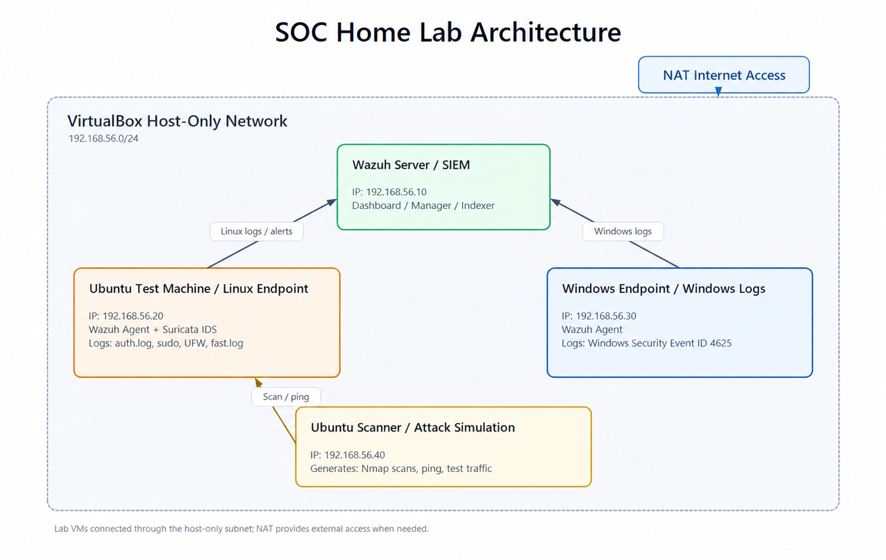

# SOC Home Lab: Threat Detection and Incident Response

## Overview

This project is a beginner-friendly SOC home lab designed to practice security monitoring, log analysis, threat detection, and incident response using open-source tools.

The lab focuses on collecting logs from Linux/Windows endpoints, detecting suspicious activity, analyzing alerts, and documenting findings through incident reports.

## Objectives

* Build a small SOC-style lab environment.
* Collect logs from endpoints.
* Detect suspicious activity such as port scans and failed login attempts.
* Analyze alerts using a SIEM/XDR platform.
* Document findings through incident reports.
* Improve practical cybersecurity skills for internship preparation.

## Tools Used

| Tool                       | Purpose                                                 | Status              |
|----------------------------|---------------------------------------------------------|---------------------|
| Oracle VirtualBox          | Virtual lab environment                                 | In use              |
| Ubuntu Desktop 24.04.4 LTS | Ubuntu test machine                                     | Completed           |
| Ubuntu Scanner VM          | Dedicated scanner machine for safe Nmap testing         | Completed           |
| Ubuntu Server 24.04.4 LTS  | Wazuh server base OS                                    | Completed           |
| Wazuh SIEM/XDR             | Log collection, alert analysis, and security monitoring | Installed           |
| Nmap                       | Safe scan activity and network testing                  | Installed           |
| OpenSSH Server             | SSH access and failed login detection practice          | Installed           |
| Wireshark                  | Manual packet analysis                                  | Installed on host   |
| Suricata IDS               | Network intrusion detection                             | Installed / Tested  |
| Windows Endpoint           | Windows event log collection and failed login detection | Installed / Tested  |

## Lab Architecture

| Machine             | IP Address            | Purpose                                    | Status         |
|---------------------|-----------------------|--------------------------------------------|----------------|
| Wazuh Server        | 192.168.56.10         | SIEM/XDR dashboard and log analysis        | Installed      |
| Ubuntu Test Machine | 192.168.56.20         | Monitored Ubuntu endpoint and scan target  | Agent enrolled |
| Ubuntu Scanner      | 192.168.56.40         | Dedicated scanner machine for Nmap testing | Configured     |
| Windows Endpoint    | 192.168.56.30         | Windows event log collection               | Agent enrolled |



## Detection Scenarios Tested

| Scenario                                 | Status                 |
|------------------------------------------|------------------------|
| Wazuh server setup                       | Completed              |
| Ubuntu endpoint agent enrollment         | Completed              |
| Nmap port scan detection                 | Completed              |
| Failed SSH login / brute-force detection | Completed              |
| Suspicious command execution             | Completed              |
| Safe malware test detection using EICAR  | Completed / Documented |
| Suricata network alert analysis          | Completed              |
| Windows failed login detection           | Completed              |

## Detection Summary

| Detection Scenario        | MITRE ATT&CK Mapping                                                       | Log Source / Evidence Source     | Tool Used                 | Documentation                                                                                             |
|---------------------------|----------------------------------------------------------------------------|----------------------------------|---------------------------|-----------------------------------------------------------------------------------------------------------|
| Nmap scan activity        | T1046 – Network Service Discovery                                          | UFW firewall logs                | Nmap, UFW, Wazuh review   | [Nmap Scan Incident Report](incident-reports/nmap-scan-incident.md)                                       |
| Failed SSH login          | T1110.001 – Password Guessing                                              | Linux authentication logs        | OpenSSH, Wazuh            | [Failed SSH Login Incident Report](incident-reports/failed-ssh-login-incident.md)                         |
| Suspicious sudo command   | T1003.008 – /etc/passwd and /etc/shadow; T1548.003 – Sudo and Sudo Caching | Linux sudo/authentication logs   | Wazuh                     | [Suspicious Command Incident Report](incident-reports/suspicious-command-incident.md)                     |
| EICAR safe malware test   | N/A – Safe detection validation test                                       | ClamAV scan output               | ClamAV, Wazuh review      | [EICAR Test Notes](sample-alerts/eicar-test-notes.md)                                                     |
| Network traffic detection | T1046 – Network Service Discovery                                          | Suricata `fast.log`              | Suricata, Nmap, Ping      | [Suricata and Wireshark Network Incident Report](incident-reports/suricata-wireshark-network-incident.md) |
| Windows failed login      | T1110.001 – Password Guessing                                              | Windows Security Event ID `4625` | Windows Event Logs, Wazuh | [Windows Failed Login Incident Report](incident-reports/windows-failed-login-incident.md)                 |

## Skills Demonstrated

- Virtual lab setup using Oracle VirtualBox
- Linux and Windows endpoint monitoring
- Wazuh SIEM/XDR deployment and agent enrollment
- Linux authentication log analysis
- Windows Security Event Log analysis
- Nmap scan testing in a private lab
- UFW firewall log review
- Suricata IDS rule testing
- Wireshark packet capture
- Safe malware testing using EICAR and ClamAV
- Incident report writing
- GitHub documentation and evidence collection

## Lab Progress

### Day 02 – Ubuntu VM Setup

Completed Ubuntu test machine setup using Oracle VirtualBox.

Configured and verified:

* Ubuntu 24.04.4 LTS VM
* 4096 MB RAM and 2 processors
* NAT networking
* Basic cybersecurity tools: `nmap`, `git`, `curl`, `net-tools`
* OpenSSH server socket listening on port 22
* VirtualBox snapshots for recovery

Documentation: [Day 02 – Ubuntu VM Setup](docs/day-02-ubuntu-vm-setup.md)

### Day 03 – Wazuh Server Setup

Completed Wazuh server installation using Ubuntu Server 24.04.4 LTS.

Configured and verified:

* Wazuh Server VM in Oracle VirtualBox
* 8192 MB RAM and 4 processors
* 50 GB virtual disk
* NAT networking for internet access
* Host-only IP address: `192.168.56.10`
* Wazuh installation completed successfully
* Wazuh services verified:

  * `wazuh-manager.service`
  * `wazuh-indexer.service`
  * `wazuh-dashboard.service`
  * `filebeat.service`
* Wazuh dashboard accessed from the Windows host browser
* Admin password saved privately and not uploaded to GitHub
* VirtualBox snapshot created after successful Wazuh installation

Documentation: [Day 03 – Wazuh Server Setup](docs/day-03-wazuh-server-setup.md)

### Day 04 – Ubuntu Agent Enrollment

Completed Ubuntu Test Machine enrollment as a Wazuh agent.

Configured and verified:

- Host-only network configured on Ubuntu Test Machine
- Ubuntu Test Machine assigned static IP address: `192.168.56.20`
- Wazuh Server reachable at `192.168.56.10`
- Wazuh agent installed on Ubuntu Test Machine
- Wazuh agent service verified as `active (running)`
- Ubuntu endpoint appeared in Wazuh dashboard as an active agent
- Agent details verified:
  - Agent name: `ubuntu-test-machine`
  - Agent ID: `001`
  - IP address: `192.168.56.20`
  - Operating system: Ubuntu 24.04.4 LTS
  - Wazuh agent version: 4.14.5

Documentation: [Day 04 – Ubuntu Agent Enrollment](docs/day-04-ubuntu-agent-enrollment.md)

### Day 05 – Nmap Scan Detection

Completed a safe Nmap scan detection scenario inside the private lab network.

Configured and verified:

- Ubuntu Scanner VM created as a dedicated scanner machine
- Ubuntu Scanner assigned host-only IP address: `192.168.56.40`
- Ubuntu Scanner successfully reached:
  - Wazuh Server: `192.168.56.10`
  - Ubuntu Test Machine: `192.168.56.20`
- Nmap service detection scan performed against Ubuntu Test Machine
- UFW firewall enabled on Ubuntu Test Machine
- UFW logging enabled on Ubuntu Test Machine
- SYN scan performed from Ubuntu Scanner to Ubuntu Test Machine
- UFW logs confirmed blocked scan packets from `192.168.56.40`
- Wazuh dashboard was reviewed for scan-related events
- Limitation documented: Wazuh did not clearly classify the activity as an Nmap scan during this test

Incident report: [Nmap Scan Incident Report](incident-reports/nmap-scan-incident.md)

### Day 06 – Failed SSH Login Detection

Completed a failed SSH login detection scenario inside the private lab network.

Configured and verified:

- SSH access allowed from Ubuntu Scanner to Ubuntu Test Machine
- SSH service verified as running on Ubuntu Test Machine
- Manual failed SSH login attempts generated from Ubuntu Scanner
- Invalid username used: `wronguser`
- Source IP address: `192.168.56.40`
- Target IP address: `192.168.56.20`
- Ubuntu authentication logs confirmed failed SSH attempts
- Wazuh dashboard displayed SSH-related failed login events
- Wazuh detected:
  - `sshd: Attempt to login using a non-existent user`
  - `syslog: User missed the password more than one time`
- Wazuh events confirmed the invalid username and source IP address

Incident report: [Failed SSH Login Incident Report](incident-reports/failed-ssh-login-incident.md)

### Day 07 – Suspicious Command Activity and EICAR Test

Completed suspicious command activity testing and a safe EICAR anti-malware test inside the private lab environment.

Configured and verified:

- Harmless enumeration commands executed on Ubuntu Test Machine
- Sensitive file access attempt performed safely using `/etc/shadow`
- `/etc/shadow` contents were not uploaded to GitHub
- Wazuh recorded sudo command activity
- Wazuh event details showed:
  - Source user: `ks`
  - Destination user: `root`
  - Command: `/usr/bin/head -n 5 /etc/shadow`
  - Agent: `ubuntu-test-machine`
- ClamAV installed on Ubuntu Test Machine
- EICAR test file created locally for safe anti-malware testing
- ClamAV detected the EICAR test file as `Eicar-Signature FOUND`
- Wazuh was reviewed for EICAR-related events
- Limitation documented: Wazuh did not clearly show an EICAR malware detection event during this test
- EICAR test file removed after testing
- Actual EICAR test file was not uploaded to GitHub

Incident report: [Suspicious Command Incident Report](incident-reports/suspicious-command-incident.md)

Notes: [EICAR Test Notes](sample-alerts/eicar-test-notes.md)

### Day 08 – Suricata Network Detection and Wireshark Evidence

Completed network-based detection testing using Suricata and Wireshark inside the private lab environment.

Configured and verified:

- Suricata installed on Ubuntu Test Machine
- Suricata version verified
- Suricata rules updated and configuration tested
- Host-only lab interface confirmed:
  - Interface: `enp0s8`
  - IP address: `192.168.56.20`
- Suricata started on the host-only lab interface
- Custom Suricata lab rules created for traffic from Ubuntu Scanner
- Ubuntu Scanner generated ICMP and TCP traffic against Ubuntu Test Machine
- Suricata `fast.log` showed alerts for:
  - `LAB ICMP ping from Ubuntu Scanner`
  - `LAB TCP traffic from Ubuntu Scanner`
- Suricata confirmed scanner-to-target traffic:
  - Source: `192.168.56.40`
  - Destination: `192.168.56.20`
- Wireshark captured ICMP traffic on the VirtualBox host-only network
- Wireshark evidence confirmed host-only lab traffic between Windows host and Ubuntu Test Machine
- Limitation documented: Wireshark screenshot captured host-to-endpoint traffic, while scanner-to-target traffic was confirmed through Suricata logs

Incident report: [Suricata and Wireshark Network Incident Report](incident-reports/suricata-wireshark-network-incident.md)

### Day 10 – Windows Endpoint Log Collection

Completed Windows endpoint log collection and failed login detection using Wazuh.

Configured and verified:

- Windows 11 Enterprise Evaluation VM created
- Windows Endpoint connected to NAT and host-only networks
- Host-only IP address assigned:
  - `192.168.56.30`
- Windows Endpoint successfully reached Wazuh Server:
  - `192.168.56.10`
- Wazuh agent installed on Windows Endpoint
- Wazuh service started successfully
- Windows Endpoint appeared in Wazuh dashboard as an active agent
- Agent details verified:
  - Agent name: `windows-endpoint`
  - Agent ID: `002`
  - IP address: `192.168.56.30`
  - Operating system: Microsoft Windows 11 Enterprise Evaluation
  - Wazuh agent version: 4.14.5
- Windows failed logon auditing enabled
- Local test user created for safe failed login testing
- Windows Security Event ID `4625` confirmed locally
- Wazuh dashboard displayed Windows failed login events
- Wazuh detected:
  - `Logon Failure - Unknown user or bad password`
- Wazuh events confirmed failed login activity for `testuser`

Incident report: [Windows Failed Login Incident Report](incident-reports/windows-failed-login-incident.md)

## Current Status

The lab foundation and multiple detection scenarios are completed.

Completed:

* GitHub repository created
* Ubuntu test machine created
* Wazuh server VM created
* Wazuh server installed
* Wazuh dashboard accessed successfully
* Ubuntu test machine connected to host-only lab network
* Ubuntu test machine enrolled as a Wazuh agent
* Ubuntu scanner VM created
* Safe Nmap scan performed inside the lab network
* UFW firewall logs collected as scan evidence
* Failed SSH login attempts generated manually
* Ubuntu authentication logs reviewed
* Wazuh failed SSH login events reviewed
* Suspicious command activity generated and reviewed
* Wazuh sudo command events reviewed
* EICAR safe malware test performed with ClamAV
* Suricata IDS installed and tested
* Suricata custom lab rules created
* Suricata network alerts reviewed
* Wireshark host-only lab traffic captured
* Windows endpoint VM created
* Windows endpoint enrolled as a Wazuh agent
* Windows Security Event ID 4625 reviewed
* Wazuh Windows failed login events reviewed
* Five incident reports written
* EICAR test notes documented
* Custom Suricata lab rules documented
* Final architecture diagram added
* Setup documentation and screenshots added

Next steps:

1. Prepare the project for portfolio and resume use.
2. Continue improving the lab in future versions.

## Incident Reports

- [Nmap Scan Incident Report](incident-reports/nmap-scan-incident.md)
- [Failed SSH Login Incident Report](incident-reports/failed-ssh-login-incident.md)
- [Suspicious Command Incident Report](incident-reports/suspicious-command-incident.md)
- [Suricata and Wireshark Network Incident Report](incident-reports/suricata-wireshark-network-incident.md)
- [Windows Failed Login Incident Report](incident-reports/windows-failed-login-incident.md)

## Sample Alert Notes

- [EICAR Test Notes](sample-alerts/eicar-test-notes.md)

## Detection Rules

- [Custom Suricata Lab Rules](detection-rules/custom-suricata-lab-rules.md)

## Lessons Learned

- [Lessons Learned](lessons-learned.md)

## Repository Structure

```text
soc-home-lab/
├── README.md
├── setup-guide.md
├── architecture-diagram.png
├── docs/
│   ├── day-02-ubuntu-vm-setup.md
│   ├── day-03-wazuh-server-setup.md
│   └── day-04-ubuntu-agent-enrollment.md
├── screenshots/
│   ├── day-02-ubuntu-vm-setup/
│   ├── day-03-wazuh-server-setup/
│   ├── day-04-ubuntu-agent-enrollment/
│   ├── day-05-nmap-scan-detection/
│   ├── day-06-failed-ssh-login-detection/
│   ├── day-07-suspicious-command-eicar/
│   ├── day-08-suricata-wireshark/
│   └── day-10-windows-endpoint-logs/
├── detection-rules/
│   └── custom-suricata-lab-rules.md
├── sample-alerts/
│   └── eicar-test-notes.md
├── incident-reports/
│   ├── nmap-scan-incident.md
│   ├── failed-ssh-login-incident.md
│   ├── suspicious-command-incident.md
│   ├── suricata-wireshark-network-incident.md
│   └── windows-failed-login-incident.md
└── lessons-learned.md
```

## Safety and Ethics

All testing in this project is performed only inside a private virtual lab environment.

No public systems, university networks, company networks, or third-party targets will be scanned or tested without permission.